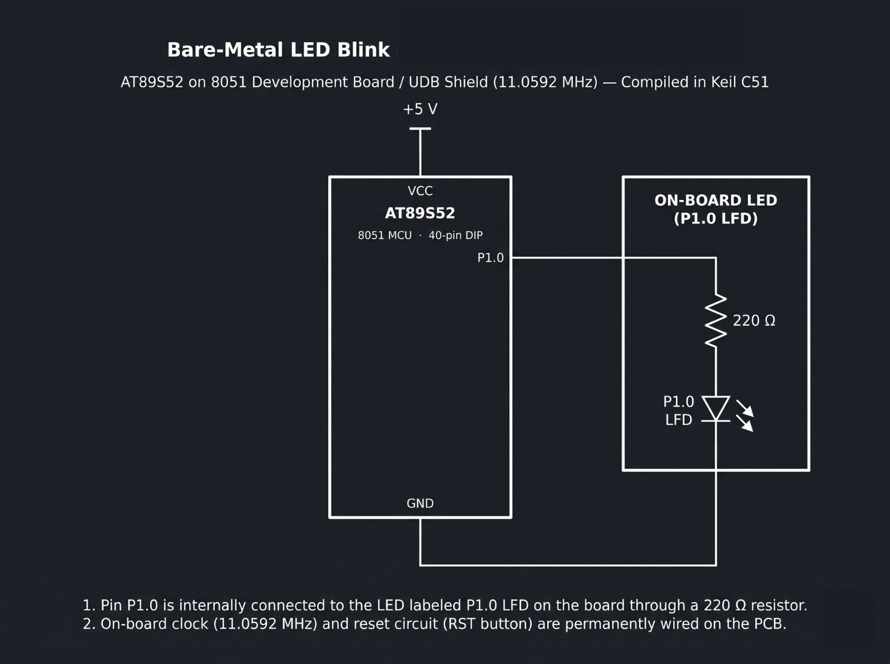

# Continuous Lab Evaluation-2

**EXP:** Continuous Lab Evaluation-2  
**DATE:** 20/07/2026  
**NAME OF EXP:** 8051 Tool Chain setup Development Board - AT89S52  
**HARDWARE SETUP / PLATFORM:** Keil C51 + 8051 Development Board (AT89S52) + On-board User LED  
**TASK NO:** 2  

---

### Circuit Diagram


---

### Core Logic

* **1. Direct Register Pin Addressing**
  Includes `<reg51.h>` for Special Function Register (SFR) definitions and maps the single-bit identifier `LED` directly to `P1^0` using the C51 `sbit` data type for bit-level GPIO control.
  ```c
  #include <reg51.h>

  sbit LED = P1^0;
  ```

* **2. Nested Software Loop Delay**
  Implements a blocking time delay using nested `for` loops to burn CPU instruction cycles between output transitions without relying on hardware timers or external libraries.
  ```c
  void delay() {
      unsigned int i, j;
      for (i = 0; i < 500; i++) {
          for (j = 0; j < 500; j++) {
          }
      }
  }
  ```

* **3. Continuous 1 Hz Toggle Loop**
  Alternates `LED` logic states (`1` and `0`) separated by `delay()` calls inside an infinite `while(1)` super-loop to generate an approximate `1 Hz` blink rate.
  ```c
  void main() {
      while (1) {
          LED = 1;
          delay();
          LED = 0;
          delay();
      }
  }
  ```

---

### Inference
Bare-metal register manipulation via `sbit` successfully drove the AT89S52 GPIO output directly, and the nested software delay loop produced a steady, visible ~1 Hz LED blink without using any HAL or RTOS abstractions.