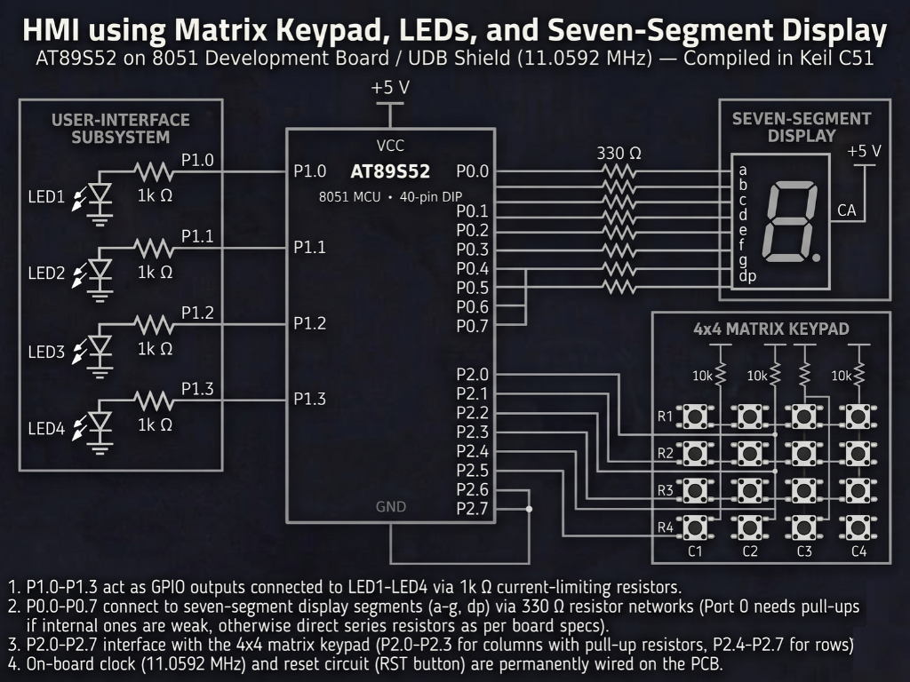

# Continuous Lab Evaluation-4

**EXP:** Continuous Lab Evaluation-4  
**DATE:** 03/08/2026  
**NAME OF EXP:** Human-Machine Interface using Matrix Keypad, LEDs, and Seven-Segment Display  
**HARDWARE SETUP / PLATFORM:** 8051 Tool Chain setup - Development Board - AT89S52  
**TASK NO:** 4  

---

### Circuit Diagram


---

### Core Logic

* **1. Matrix Keypad Scanning with Pull-Up Activation**
  Enables internal pull-ups on Port 2, sequentially drives each row pin (`P2.7`–`P2.4`) `LOW`, and reads column pins (`P2.3`–`P2.0`) to identify active-low key presses mapped to digits `0–9`.
  ```c
  for(row = 0; row < 4; row++) {
      P2 = 0xFF;                     // Enable pull-ups on columns & set rows HIGH
      P2 &= ~(1 << rowPin[row]);     // Drive current row LOW
      for(col = 0; col < 4; col++) {
          if((P2 & (1 << colPin[col])) == 0)
              return keypad[row][col];
      }
  }
  ```

* **2. Seven-Segment Visual Feedback**
  Maps the active mode (`0–9`) to a common-cathode hexadecimal lookup table and outputs the bitmask directly to Port 0, blanking the display when idle (`mode = -1`).
  ```c
  static const unsigned char digit[10] = {
      0x3F, 0x06, 0x5B, 0x4F, 0x66, 0x6D, 0x7D, 0x07, 0x7F, 0x6F
  };
  P0 = (value >= 0 && value <= 9) ? digit[value] : 0x00;
  ```

* **3. Non-Blocking Mode Dispatch & LED Pattern Execution**
  Uses `keypad_wait()` inside every LED mode loop so that dynamic animations (running LEDs, alternating `0101`/`1010`, binary counter `0–15`, and all-blink) can be interrupted immediately upon a new key press, while key `0` resets the system state.
  ```c
  switch(mode) {
      case 1: led_control(mode) break;
      case 2: led_control(mode); break;
      case 3: led_control(mode); break;
      case 4: led_control(mode); break;
      case 5: running_led(); break;
      case 6: alternate_led(); break;
      case 7: binary_counter(); break;
      case 8: blink_all(); break;
      case 9: led_pattern(0x00); break;
      case 0: P0 = 0x00; P1 = 0x00; mode = -1; break;
  }
  ```

---

### Inference
A bare-metal Human-Machine Interface was successfully implemented on the AT89S52 microcontroller using direct register-level port manipulation (`P0`, `P1`, `P2`) without external libraries or RTOS overhead. Polling the 4x4 matrix keypad during short delay intervals ensured immediate responsiveness across static LED controls, dynamic bit-shifting animations, binary counting, and full system reset while maintaining synchronized feedback on the seven-segment display.