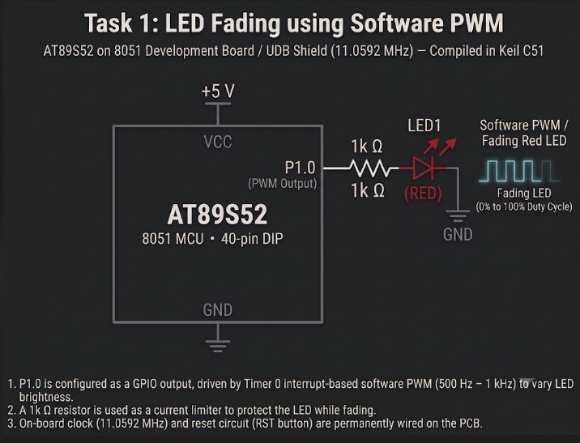

# Continuous Lab Evaluation-5 

**EXP:** Continuous Lab Evaluation-5  
**DATE:** 10/08/2026  
**NAME OF EXP:** Hardware Timer and Interrupt-Based Timing for LED Fading, Pulse Generation, and Stepper Motor Control  
**HARDWARE SETUP / PLATFORM:** Keil uVision + 8051 Development Board (AT89S52, 11.0592 MHz) + LED + Oscilloscope + Multimeter  
**TASK NO:** 1  

---

### Circuit Diagram


---

### Core Logic

* **1. Timer 0 1 ms Periodic Interrupt Configuration**
  Configures Timer 0 in 16-bit Mode 1 (`TMOD = 0x01`) with preload `0xFC66` ($65536 - 922 = 64614$, where $922 \times 1.085\ \mu\text{s} \approx 1\text{ ms}$) and enables Timer 0 and global interrupts (`ET0`, `EA`).
  ```c
  TMOD = 0x01;
  TH0 = 0xFC;
  TL0 = 0x66;

  ET0 = 1;
  EA  = 1;
  TR0 = 1;
  ```

* **2. Software Time Base & 1-Second LED Toggle**
  Reloads `0xFC66` inside `timer0_ISR` on every `1 ms` overflow and increments a software tick counter (`ms_count`), toggling the LED (`LED = ~LED`) every `1000` ticks (`1 second`) without blocking the `while(1)` main loop.
  ```c
  void timer0_ISR(void) interrupt 1
  {
      TH0 = 0xFC;
      TL0 = 0x66;

      if (++ms_count >= 1000) {
          ms_count = 0;
          LED = ~LED;
      }
  }
  ```

---

### Inference
Hardware Timer 0 interrupts on the AT89S52 ($11.0592\text{ MHz}$) generated an accurate $1\text{ ms}$ periodic time base using the `0xFC66` reload value. Counting $1000$ interrupt ticks produced a precise $1\text{ second}$ LED toggle interval verified on the oscilloscope without any blocking delay loops.