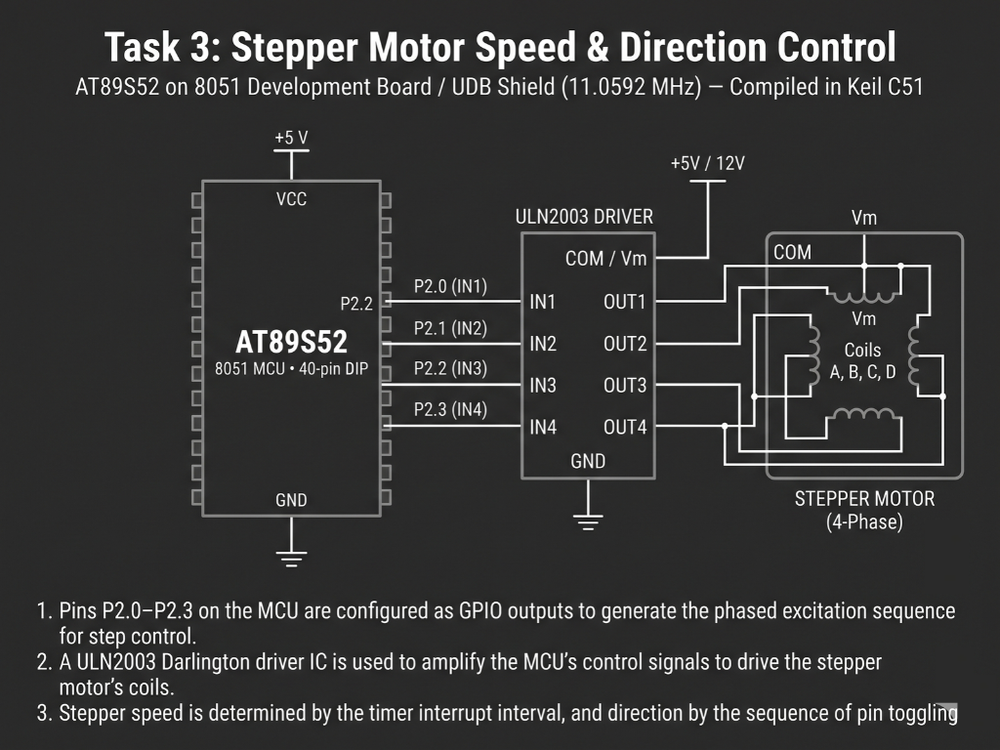

# Continuous Lab Evaluation-5

**EXP:** Continuous Lab Evaluation-5  
**DATE:** 10/08/2026  
**NAME OF EXP:** Hardware Timer and Interrupt-Based Timing for LED Fading, Pulse Generation, and Stepper Motor Control  
**HARDWARE SETUP / PLATFORM:** Keil uVision + 8051 Development Board (AT89S52, 11.0592 MHz) + Stepper Motor (ULN2003 Driver) + 4x4 Matrix Keypad + Multimeter  
**TASK NO:** 3  

---

### Circuit Diagram


---

### Core Logic

* **1. Timer 0 10 ms System Time Base**
  Initializes Timer 0 in Mode 1 (`TMOD = 0x01`) with preload `0xDC00` ($9216 \times 1.085\ \mu\text{s} = 10\text{ ms}$) to generate a periodic stepping time base.
  ```c
  void timer0_init(void)
  {
      TMOD = 0x01;
      TH0 = 0xDC;
      TL0 = 0x00;
      ET0 = 1;
      EA  = 1;
      TR0 = 1;
  }
  ```

* **2. Keypad Step Interval Scaling**
  Maps keypad presses (`1`–`3`) to `step_interval` multipliers, scaling the $10\text{ ms}$ interrupt into Fast ($10\text{ ms/step}$), Medium ($50\text{ ms/step}$), and Slow ($100\text{ ms/step}$) motor speeds.
  ```c
  void set_speed(int key)
  {
      switch(key)
      {
          case 1: step_interval = 1;  break; // 10 ms/step (Fast)
          case 2: step_interval = 5;  break; // 50 ms/step (Medium)
          case 3: step_interval = 10; break; // 100 ms/step (Slow)
      }
  }
  ```

* **3. Interrupt-Driven Single-Phase Coil Stepping**
  Increments `timer_count` inside `timer0_ISR` and triggers `step_motor()` once `step_interval` is reached, shifting the coil excitation pattern (`0x08` $\rightarrow$ `0x04` $\rightarrow$ `0x02` $\rightarrow$ `0x01`) on Port 1.
  ```c
  void step_motor(void)
  {
      coil = (coil == 0x01) ? 0x08 : (coil >> 1);
      P1 = coil;
  }

  void timer0_ISR(void) interrupt 1
  {
      TH0 = 0xDC;
      TL0 = 0x00;
      if (++timer_count >= step_interval) {
          timer_count = 0;
          step_motor();
      }
  }
  ```

---

### Inference
Using a $10\text{ ms}$ Timer 0 interrupt base with a software tick divider achieved smooth, non-blocking stepper motor speed control across $10\text{ ms}$, $50\text{ ms}$, and $100\text{ ms}$ step intervals without missing steps during keypad polling.