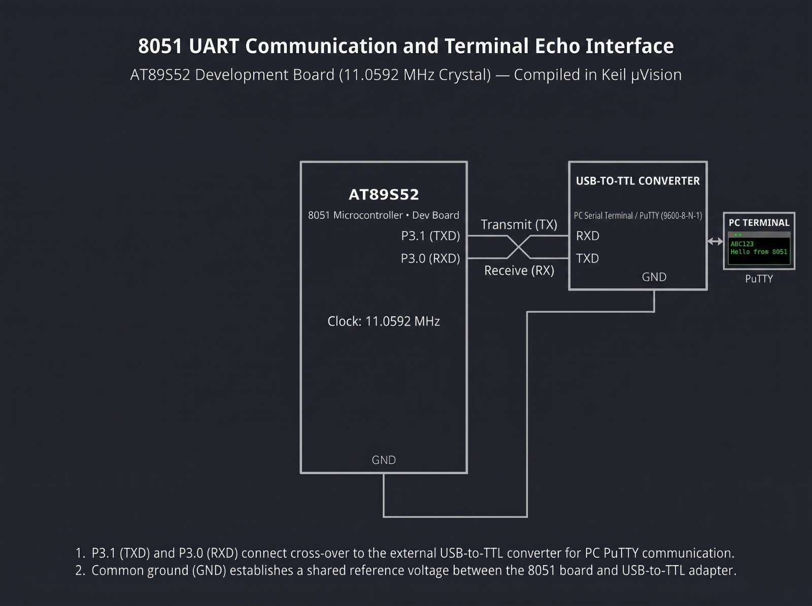

# Continuous Lab Evaluation-6 

**EXP:** Continuous Lab Evaluation-6  
**DATE:** 17/08/2026  
**NAME OF EXP:** UART Driver and Serial Debugging — UART Initialization and Character Transmission  
**HARDWARE SETUP / PLATFORM:** Keil µVision + 8051 Development Board (AT89S52 @ 11.0592 MHz) + USB-to-TTL Converter + PC Terminal (PuTTY)  
**TASK NO:** Task A  

---

### Circuit Diagram


---

### Core Logic

* **1. 9600-8-N-1 UART & Timer 1 Initialization**
  Configures `SCON` (`0x50`) for Mode 1 (8-bit asynchronous UART with reception enabled) and sets Timer 1 in Mode 2 (8-bit auto-reload) with `TH1 = 0xFD` to generate an exact 9600 baud rate from the 11.0592 MHz crystal.
  ```c
  void UART_Init(void) {
      SCON = 0x50;  // 8-bit UART, REN enabled
      TMOD |= 0x20; // Timer 1, Mode 2 (8-bit auto-reload)
      TH1 = 0xFD;   // 9600 baud rate at 11.0592 MHz
      TR1 = 1;      // Start Timer 1
  }
  ```

* **2. Polling-Based Character Transmission**
  Loads a single byte into `SBUF`, monitors the Transmit Interrupt flag (`TI`) until hardware shifting completes, and manually clears `TI` in software before sending the next byte.
  ```c
  void UART_TxChar(char ch) {
      SBUF = ch;
      while (!TI);   // Wait until transmission is complete
      TI = 0;        // Clear transmit interrupt flag
  }
  ```

* **3. Continuous String Streaming**
  Iterates through the null-terminated `"Hello from 8051\r\n"` character array in an infinite loop, streaming formatted lines continuously to PuTTY.
  ```c
  void UART_TxString(char *str) {
      while (*str) {
          UART_TxChar(*str++);
      }
  }
  ```

---

### Inference
The AT89S52 UART peripheral was successfully configured in Mode 1 at 9600-8-N-1 using Timer 1 auto-reload mode (`TH1 = 0xFD`) with an 11.0592 MHz crystal. Polling the `TI` flag ensured reliable byte-by-byte framing without buffer overwrites, continuously displaying `"Hello from 8051"` on the PuTTY terminal via the USB-to-TTL interface.