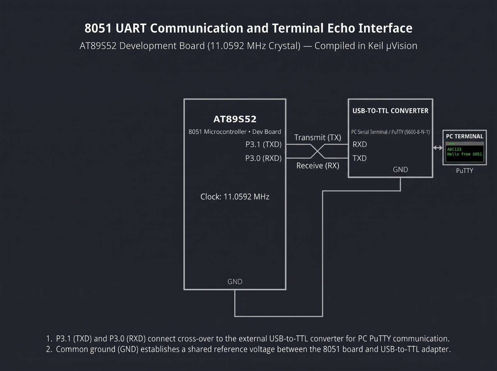

# Continuous Lab Evaluation-6

**EXP:** Continuous Lab Evaluation-6  
**DATE:** 17/08/2026  
**NAME OF EXP:** UART Driver and Serial Debugging — UART Echo  
**HARDWARE SETUP / PLATFORM:** Keil µVision + 8051 Development Board (AT89S52 @ 11.0592 MHz) + USB-to-TTL Converter + PC Terminal (PuTTY)  
**TASK NO:** Task B  

---

### Circuit Diagram


---

### Core Logic

* **1. Interrupt-Enabled UART Initialization**
  Initializes Timer 1 (`TH1 = 0xFD`) and `SCON` (`0x50`) for 9600-8-N-1 communication, then enables the serial interrupt (`ES = 1`) and global interrupts (`EA = 1`) so incoming bytes trigger an immediate hardware vector jump.
  ```c
  void UART_Init(void) {
      SCON = 0x50;  // Mode 1: 8-bit UART, receiver enabled
      TMOD |= 0x20; // Timer 1: Mode 2 (8-bit auto-reload)
      TH1 = 0xFD;   // 9600 baud rate at 11.0592 MHz
      TR1 = 1;      // Start Timer 1
      ES = 1;       // Enable Serial interrupt
      EA = 1;       // Enable Global interrupt
  }
  ```

* **2. Serial ISR (`interrupt 4`) & Real-Time Echo**
  Executes automatically when either `RI` or `TI` is asserted. Upon reception (`RI == 1`), the ISR clears `RI`, reads the received character from `SBUF`, and writes it immediately back to `SBUF` to echo the character to PuTTY, clearing `TI` once transmission finishes.
  ```c
  void serial_interrupt(void) interrupt 4 {
      if (RI) {
          RI = 0;            // Clear receive interrupt flag
          rx_data = SBUF;    // Read received character
          SBUF = rx_data;    // Echo character back to transmitter
      }
      if (TI) {
          TI = 0;            // Clear transmit interrupt flag
      }
  }
  ```

---

### Inference
An interrupt-driven UART echo driver (`interrupt 4`) was successfully implemented on the AT89S52 without blocking the main execution loop. Every character typed in PuTTY triggered the receive interrupt (`RI`), was retrieved from `SBUF`, and echoed back instantaneously to the PC terminal with zero data loss.