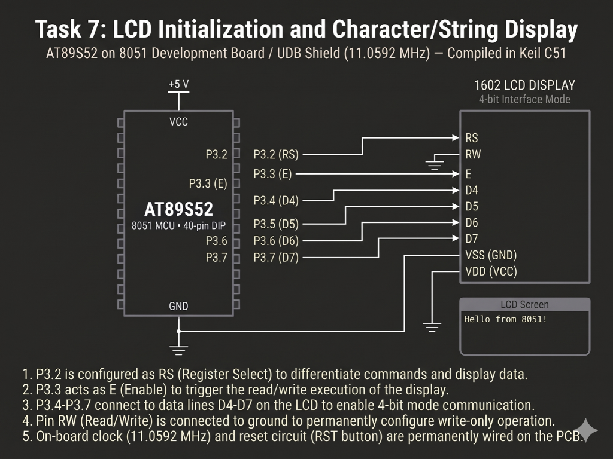

# Continuous Lab Evaluation-7 

**EXP:** Continuous Lab Evaluation-7  
**DATE:** 24/08/2026  
**NAME OF EXP:** 16×2 LCD Driver Development and Dynamic Display Control  
**HARDWARE SETUP / PLATFORM:** 8051 Tool Chain setup + Keil + Development Board AT89S52 (11.0592 MHz) + 16×2 HD44780 Character LCD  
**TASK NO:** 7A  

---

### Circuit Diagram


---

### Core Logic

* **1. 4-Bit Nibble Transmission & Enable Pulse**
  Splits each 8-bit command or data byte into upper and lower 4-bit nibbles, sets `RS` (`0` for command, `1` for data), places the nibble onto the upper nibble of `Port 3`, and latches it via a high-to-low transition on `EN`.
  ```c
  void lcd_nibble(unsigned char nibble, bit rs_val) {
      RS = rs_val;
      P3 = (P3 & 0x0F) | ((nibble & 0x0F) << 4);
      EN = 1;
      _nop_();
      _nop_();
      EN = 0;
  }
  ```

* **2. HD44780 4-Bit Initialization Sequence**
  Executes the datasheet power-on reset sequence (`0x03` repeated three times followed by `0x02`) to switch the controller into 4-bit interface mode, then configures 2-line display (`0x28`), display ON (`0x0C`), screen clear (`0x01`), and auto-increment cursor (`0x06`).
  ```c
  lcd_nibble(0x03, 0); delay_ms(5);
  lcd_nibble(0x03, 0); delay_ms(1);
  lcd_nibble(0x03, 0); delay_ms(1);
  lcd_nibble(0x02, 0); delay_ms(1);

  lcd_cmd(0x28); // 4-bit mode, 2 lines, 5x8 font
  lcd_cmd(0x0C); // Display ON, Cursor OFF
  lcd_cmd(0x01); // Clear display
  lcd_cmd(0x06); // Entry mode: increment cursor
  ```

* **3. Multi-Row Character & String Display**
  Sets the DDRAM starting addresses (`0x80` for Row 1, `0xC0` for Row 2) and sequentially writes null-terminated ASCII characters using `lcd_data()`.
  ```c
  lcd_cmd(0x80);
  lcd_str("Row 1: Task 7A");

  lcd_cmd(0xC0);
  lcd_str("Hello World!");
  ```

---

### Inference
A low-level 4-bit GPIO driver for the HD44780 LCD controller was successfully implemented on the AT89S52 without external HAL libraries. Following the datasheet timing and nibble-splitting protocol enabled reliable initialization and multi-line ASCII string rendering across both rows of the 16×2 display.