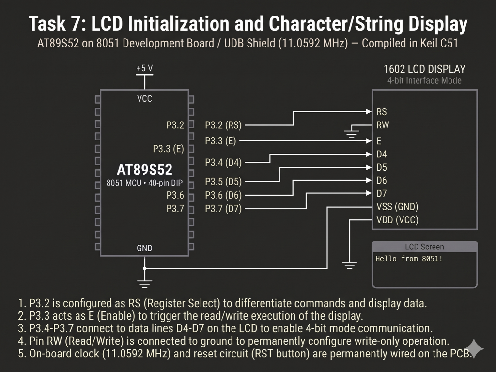

# Continuous Lab Evaluation-7 

**EXP:** Continuous Lab Evaluation-7  
**DATE:** 24/08/2026  
**NAME OF EXP:** 16×2 LCD Driver Development and Dynamic Display Control  
**HARDWARE SETUP / PLATFORM:** 8051 Tool Chain setup + Keil + Development Board AT89S52 (11.0592 MHz) + 16×2 HD44780 Character LCD  
**TASK NO:** 7B  

---

### Circuit Diagram


---

### Core Logic

* **1. DDRAM Cursor Positioning (`lcd_goto` & `lcd_puts`)**
  Maps `(row, col)` coordinates to the HD44780 DDRAM address space (`0x00` offset for Row 0, `0x40` offset for Row 1) and issues the Set DDRAM Address command (`0x80 | address`) before writing strings.
  ```c
  void lcd_goto(unsigned char row, unsigned char col) {
      unsigned char address;
      if (row >= LCD_ROWS || col >= LCD_COLS) return;

      address = (row == 0) ? col : (0x40 + col);
      lcd_cmd(0x80 | address);
  }
  ```

* **2. Integer-to-ASCII Conversion (`lcd_print_number`)**
  Extracts decimal digits in reverse order using modulo-10 division, stores them in a temporary buffer, and transmits each digit as an ASCII character (`digit + '0'`) from most-significant to least-significant digit.
  ```c
  while (value > 0) {
      digits[i++] = value % 10;
      value /= 10;
  }
  while (i > 0) {
      i--;
      lcd_data(digits[i] + '0');
  }
  ```

* **3. Dynamic Screen Refresh**
  Repositions the cursor to the target coordinates in the main loop to overwrite old numerical values cleanly with trailing spaces to prevent ghost digits.
  ```c
  lcd_goto(1, 0);
  lcd_print_number(counter);
  lcd_str("     ");
  ```

---

### Inference
Direct DDRAM address mapping allowed precise cursor placement anywhere on the 16×2 character grid. Combining modulo-based integer extraction with targeted cursor repositioning enabled flicker-free, dynamic updates of live numerical data on the display.