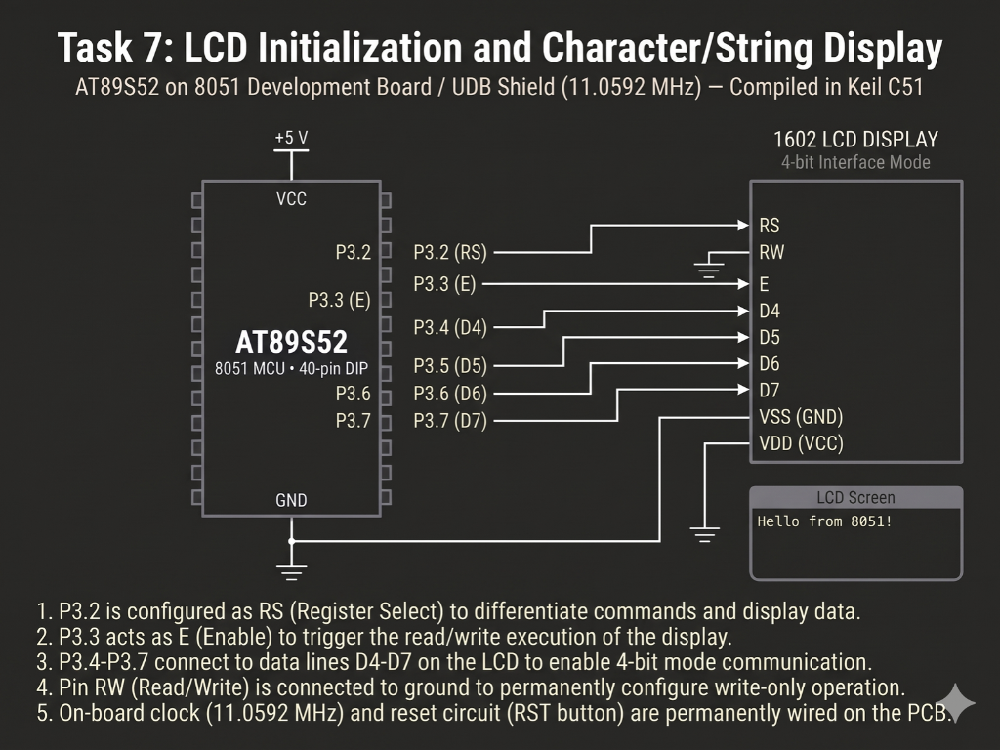

# Continuous Lab Evaluation-7 

**EXP:** Continuous Lab Evaluation-7  
**DATE:** 24/08/2026  
**NAME OF EXP:** 16×2 LCD Driver Development and Dynamic Display Control  
**HARDWARE SETUP / PLATFORM:** 8051 Tool Chain setup + Keil + Development Board AT89S52 (11.0592 MHz) + 16×2 HD44780 Character LCD + 4×4 Matrix Keypad  
**TASK NO:** 7C  

---

### Circuit Diagram


---

### Core Logic

* **1. 4×4 Matrix Keypad Scanning (`keypad_scan`)**
  Drives one row low at a time on the upper nibble of `Port 2` while polling the lower nibble columns for a logic-low signal to decode the pressed key from a 2D lookup table.
  ```c
  for (row = 0; row < 4; row++) {
      P2 |= 0xF0;
      P2 &= ~(1 << rowPin[row]);

      for (col = 0; col < 4; col++) {
          if ((P2 & (1 << colPin[col])) == 0) {
              return keypad[row][col];
          }
      }
  }
  ```

* **2. Bounded Coordinate Update & Character Redraw (`move_char`)**
  Erases the character at the current `(cur_row, cur_col)` by writing a blank space (`' '`), updates coordinates within grid boundaries (`0–1` rows, `0–15` columns) for keys `'2'` (Up), `'8'` (Down), `'4'` (Left), and `'6'` (Right), and redraws `'*'` at the new location.
  ```c
  lcd_goto(cur_row, cur_col);
  lcd_data(' ');

  switch (direction) {
      case '6': if (cur_col < LCD_COLS - 1) cur_col++; break;
      case '4': if (cur_col > 0) cur_col--; break;
      case '8': if (cur_row < LCD_ROWS - 1) cur_row++; break;
      case '2': if (cur_row > 0) cur_row--; break;
  }

  lcd_goto(cur_row, cur_col);
  lcd_data(MOVE_CHAR);
  ```

* **3. Key-Release & Debounce Handling**
  Blocks execution until the pressed key is released (`while (keypad_scan() != -1);`) followed by a `50 ms` delay so each button press registers as a single discrete step.

---

### Inference
Row-column matrix scanning on `Port 2` was successfully integrated with the 4-bit LCD driver on `Port 3` to create a responsive interactive display. Implementing boundary checks, erase-before-draw cursor updates, and key-release debouncing ensured smooth, single-step character navigation across the 16×2 screen.