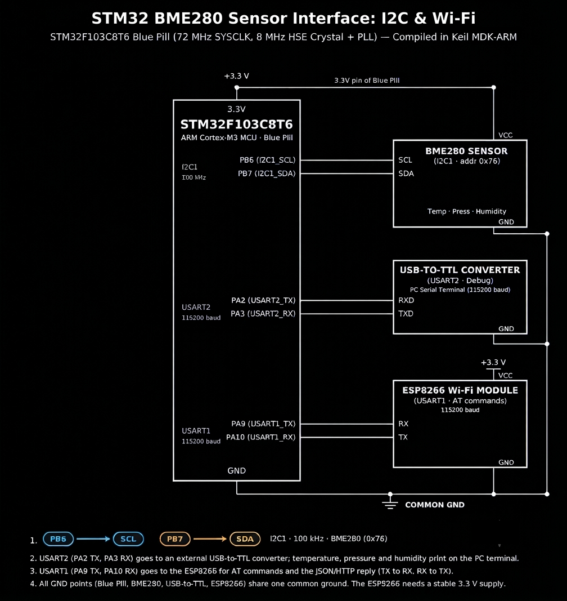

# Continuous Lab Evaluation-13

**EXP:** Continuous Lab Evaluation-13  
**DATE:** 23/10/2026  
**NAME OF EXP:** BME280 Sensor Interfacing Using I²C and Bosch Sensor API  
**HARDWARE SETUP / PLATFORM:** CubeMX + Keil MDK + STM32 BluePill (STM32F103C8T6) + Debugger + BME280 Sensor + ESP8266 (Wi-Fi)  
**TASK NO:** 13 

---

### Circuit Diagram


---

### Core Logic

* **1. Bosch API Driver & I²C Initialization**
  Links custom STM32 HAL I²C read/write and delay callbacks to the `bme280_dev` structure, verifies the sensor chip ID (`0x60`), extracts factory trimming parameters, and configures oversampling (`1X`) in normal power mode.
  ```c
  dev.intf_ptr = &dev_addr;
  dev.intf = BME280_I2C_INTF;
  dev.read = user_i2c_read;
  dev.write = user_i2c_write;
  dev.delay_us = user_delay_us;

  rslt = bme280_init(&dev);
  rslt = bme280_set_sensor_mode(BME280_MODE_NORMAL, &dev);
  ```

* **2. Compensated Data Acquisition & UART Debugging**
  Polls raw pressure, temperature, and humidity registers every second, applies Bosch compensation algorithms, converts pressure from Pa to hPa, and prints formatted readings over `USART2`.
  ```c
  rslt = bme280_get_sensor_data(BME280_ALL, &comp_data, &dev);
  if (rslt == BME280_OK) {
      temperature = comp_data.temperature;
      pressure = comp_data.pressure / 100.0f;
      humidity = comp_data.humidity;
  }
  ```

* **3. Dynamic JSON & Raw HTTP Response Generation**
  Serializes compensated readings into a JSON string, computes its exact `Content-Length` dynamically via `strlen()`, constructs a full `HTTP/1.1 200 OK` response, and transmits it to the ESP8266 over `USART1` using `AT+CIPSEND`.
  ```c
  snprintf(json_payload, sizeof(json_payload),
           "{\"status\":\"success\",\"temperature\":%.2f,\"humidity\":%.2f,\"pressure\":%.2f}",
           temperature, humidity, pressure);
  int content_length = strlen(json_payload);

  snprintf(http_response, sizeof(http_response),
           "HTTP/1.1 200 OK\r\nContent-Type: application/json\r\nContent-Length: %d\r\n\r\n%s",
           content_length, json_payload);

  snprintf(at_cmd, sizeof(at_cmd), "AT+CIPSEND=0,%d\r\n", (int)strlen(http_response));
  HAL_UART_Transmit(&huart1, (uint8_t*)at_cmd, strlen(at_cmd), HAL_MAX_DELAY);
  HAL_UART_Transmit(&huart1, (uint8_t*)http_response, strlen(http_response), HAL_MAX_DELAY);
  ```

* **4. Node-RED Statistical Analytics**
  Polls the ESP8266 HTTP endpoint, parses the incoming JSON payload, and maintains a rolling array in flow context to compute real-time **Minimum**, **Maximum**, and **Average** values for temperature, humidity, and pressure.
  ```javascript
  let history = flow.get('bme280_history') || { temp: [], hum: [], press: [] };
  history.temp.push(msg.payload.temperature);
  history.hum.push(msg.payload.humidity);
  history.press.push(msg.payload.pressure);

  const getMin = arr => Math.min(...arr).toFixed(2);
  const getMax = arr => Math.max(...arr).toFixed(2);
  const getAvg = arr => (arr.reduce((a, b) => a + b, 0) / arr.length).toFixed(2);
  ```

---

### Inference
The Bosch Sensortec BME280 API was successfully interfaced with the STM32 microcontroller over I²C using custom HAL wrapper functions to acquire accurate, compensated temperature, pressure, and humidity readings. Dynamically computing `Content-Length` ensured valid HTTP/1.1 JSON framing over the ESP8266 Wi-Fi link, enabling Node-RED to ingest the live telemetry stream and reliably compute real-time minimum, maximum, and average environmental statistics.