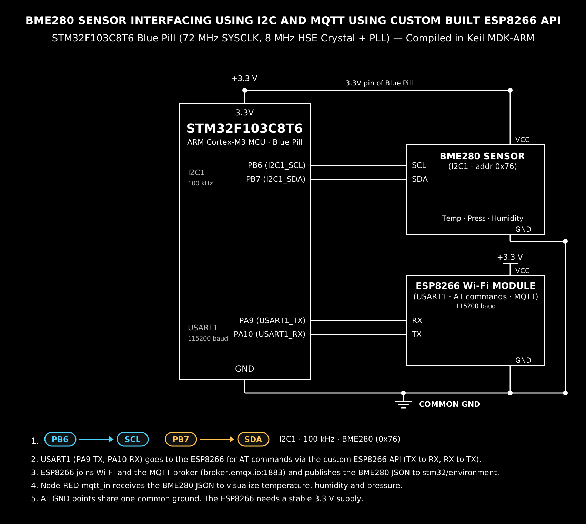
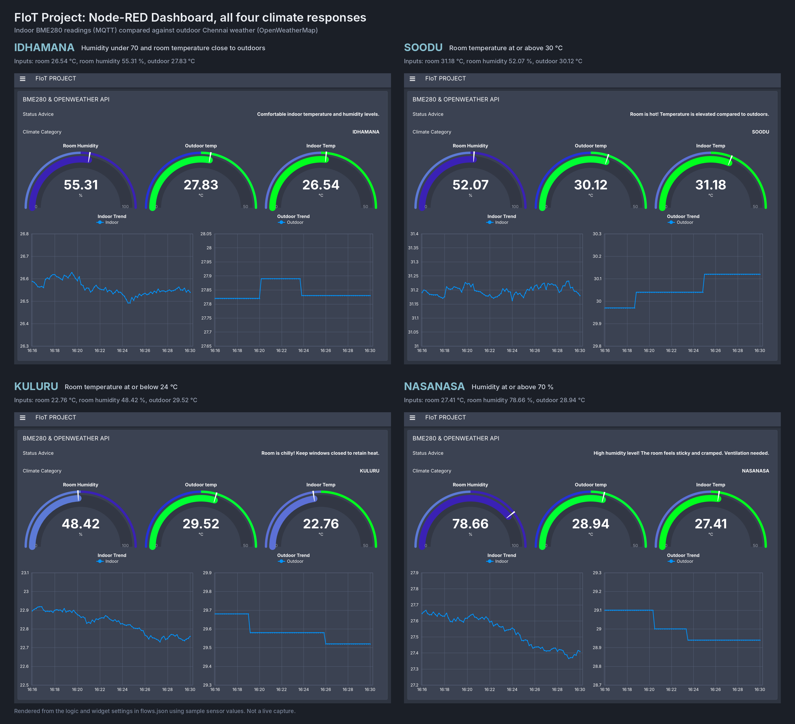

# Continuous Lab Evaluation-15

**EXP:** Continuous Lab Evaluation-15  
**DATE:** 12/11/2026  
**NAME OF EXP:** IoT Environmental Monitoring, Weather API Comparison, and Closed-Loop Control Using BME280, MQTT, and Node-RED  
**HARDWARE SETUP / PLATFORM:** CubeMX + Keil MDK-ARM + STM32 BluePill (STM32F103C8T6) + ST-Link Debugger + BME280 Sensor + WeMos ESP8266 (Wi-Fi) + USB-to-TTL Adapter  
 

---

### Circuit Diagram


---

### Core Logic

* **1. BME280 Sensor Acquisition & MQTT Telemetry Publishing (STM32)**
  Polls compensated temperature, humidity, and pressure from the BME280 over `I2C1` every 5 seconds, formats the readings into a JSON payload, and publishes it to `stm32/environment` via the ESP8266 UART bridge (`USART1`).
  ```c
  if ((HAL_GetTick() - lastPubTime) > 5000) {
      lastPubTime = HAL_GetTick();
      struct bme280_data comp_data;
      bme280_get_sensor_data(BME280_ALL, &comp_data, &bme280);

      char payload[128];
      snprintf(payload, sizeof(payload),
          "{\"room_temp\":%.2f,\"room_hum\":%.2f,\"room_press\":%.2f,\"count\":%u}",
          comp_data.temperature, comp_data.humidity, comp_data.pressure / 100.0, count++);

      MQTT_publishTopic("stm32/environment", payload, 0);
  }
  ```

* **2. Asynchronous Data Synchronization & Climate Decision Engine (Node-RED)**
  Merges incoming indoor MQTT telemetry with periodic OpenWeatherMap API outdoor weather data (`Chennai`) in flow context, classifies room comfort into **Nasanasa**, **Soodu**, **Kuluru**, or **Idhamana**, and routes values to the dashboard and control loop.
  ```javascript
  if (msg.payload.room_temp !== undefined) {
      flow.set('room_temp', msg.payload.room_temp);
      flow.set('room_hum', msg.payload.room_hum);
  } else if (msg.payload.main !== undefined) {
      flow.set('outdoor_temp', msg.payload.main.temp);
      flow.set('outdoor_hum', msg.payload.main.humidity);
  }

  let roomTemp = flow.get('room_temp') || 0;
  let outdoorTemp = flow.get('outdoor_temp') || 0;
  let roomHum = flow.get('room_hum') || 0;

  let category = "IDHAMANA";
  let description = "";
  let command = "OFF";

  if (roomHum >= 70.0) {
      category = "NASANASA";
      description = "High humidity level! The room feels sticky and cramped.";
      command = "ON";
  } else if (roomTemp >= 30.0 || roomTemp > outdoorTemp + 2.0) {
      category = "SOODU";
      description = "Room is hot! Temperature is elevated compared to outdoors.";
      command = "ON";
  } else if (roomTemp <= 24.0 || roomTemp < outdoorTemp - 2.0) {
      category = "KULURU";
      description = "Room is chilly! Keep windows closed to retain heat.";
      command = "OFF";
  } else {
      category = "IDHAMANA";
      description = "Comfortable indoor temperature and humidity levels.";
      command = "OFF";
  }
  ```

---

### Dashboard


---

### Inference
A closed-loop IoT environmental monitoring and control system was successfully implemented by combining local BME280 sensor telemetry over `I2C1` with live OpenWeatherMap API data in Node-RED. Routing JSON telemetry and control commands over MQTT (`broker.emqx.io`) enabled real-time climate classification (**Nasanasa**, **Soodu**, **Kuluru**, **Idhamana**) on the Node-RED Dashboard.