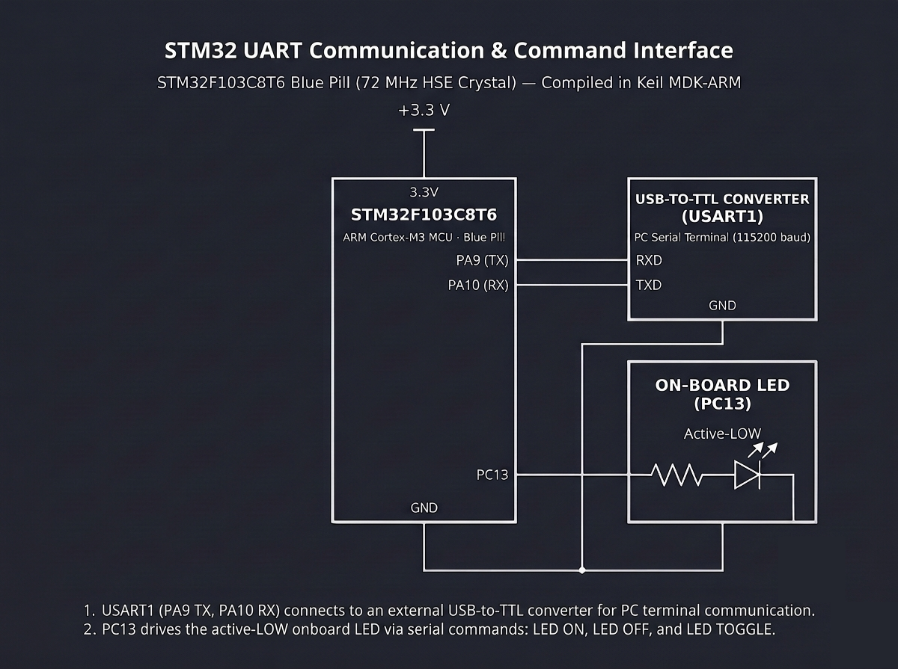

# Continuous Lab Evaluation-9

**EXP:** Continuous Lab Evaluation-9

**DATE:** 28/09/2026

**NAME OF EXP:** STM32 UART Command Controlled LED

**HARDWARE SETUP / PLATFORM:** CubeMX + Keil MDK + STM32 Development Board (STM32F103C8T6 Blue Pill) + USB-to-TTL Converter

**TASK NO:** 9B

---

### Circuit Diagram


---

### Core Logic

* **1. Line-Buffered String Accumulation & Echo**
  Receives individual bytes over `USART1` with a 5 ms timeout, echoes them back for terminal visibility, and appends them into `rx_buffer` until a Carriage Return (`\r`) or Line Feed (`\n`) is detected.

  ```
  if (HAL_UART_Receive(&huart1, &rx_byte, 1, 5) == HAL_OK) {
      HAL_UART_Transmit(&huart1, &rx_byte, 1, 10);
      if (rx_byte == '\r' || rx_byte == '\n') {
          rx_buffer[rx_index] = '\0';
      } else if (rx_index < sizeof(rx_buffer) - 1) {
          rx_buffer[rx_index++] = (char)rx_byte;
      }
  }
  
  ```

* **2. Command Parsing & State Transition**
  Compares the null-terminated command string against `"LED ON"`, `"LED OFF"`, and `"LED TOGGLE"` using `strcmp()`, updates `led_mode`, transmits confirmation feedback, and resets the buffer.

  ```
  if (strcmp(rx_buffer, "LED ON") == 0) {
      led_mode = 1;
      HAL_UART_Transmit(&huart1, (uint8_t *)"LED turned ON\r\n", 15, 100);
  } else if (strcmp(rx_buffer, "LED OFF") == 0) {
      led_mode = 0;
      HAL_UART_Transmit(&huart1, (uint8_t *)"LED turned OFF\r\n", 16, 100);
  } else if (strcmp(rx_buffer, "LED TOGGLE") == 0) {
      led_mode = 2;
      HAL_UART_Transmit(&huart1, (uint8_t *)"LED toggled (blinking)\r\n", 24, 100);
  }
  
  ```

* **3. Non-Blocking LED State Controller**
  Evaluates `led_mode` continuously inside the main loop to drive the active-LOW onboard LED (`PC13`) steady ON, OFF, or continuously blinking at 250 ms intervals via `HAL_GetTick()`.

  ```
  if (led_mode == 0) {
      HAL_GPIO_WritePin(GPIOC, GPIO_PIN_13, GPIO_PIN_SET);
  } else if (led_mode == 1) {
      HAL_GPIO_WritePin(GPIOC, GPIO_PIN_13, GPIO_PIN_RESET);
  } else if (led_mode == 2 && (HAL_GetTick() - last_blink_time >= 250)) {
      HAL_GPIO_TogglePin(GPIOC, GPIO_PIN_13);
      last_blink_time = HAL_GetTick();
  }
  
  ```

---

### Inference

A string-based UART command interpreter was successfully implemented on the STM32 Blue Pill using delimiter-based (`\r`/`\n`) line buffering and `strcmp()` parsing. Decoupling the non-blocking `HAL_GetTick()` LED state machine from UART polling ensured that `LED TOGGLE` maintained continuous blinking without blocking incoming serial commands.